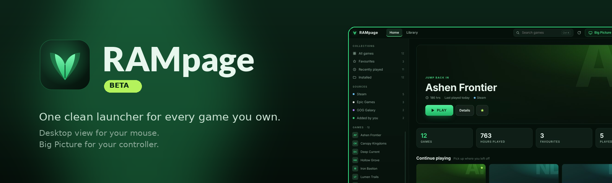
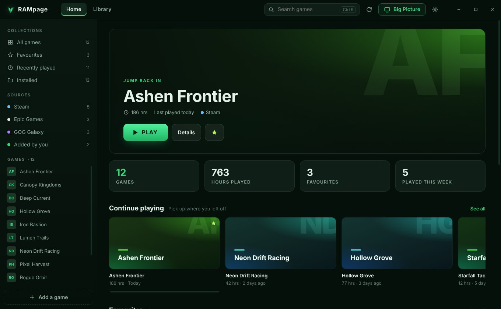
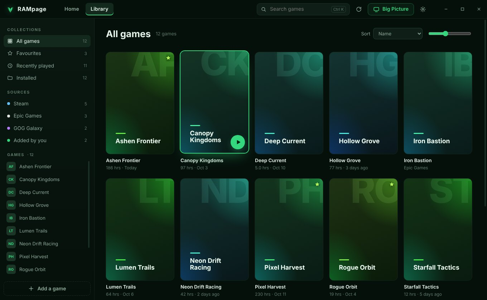
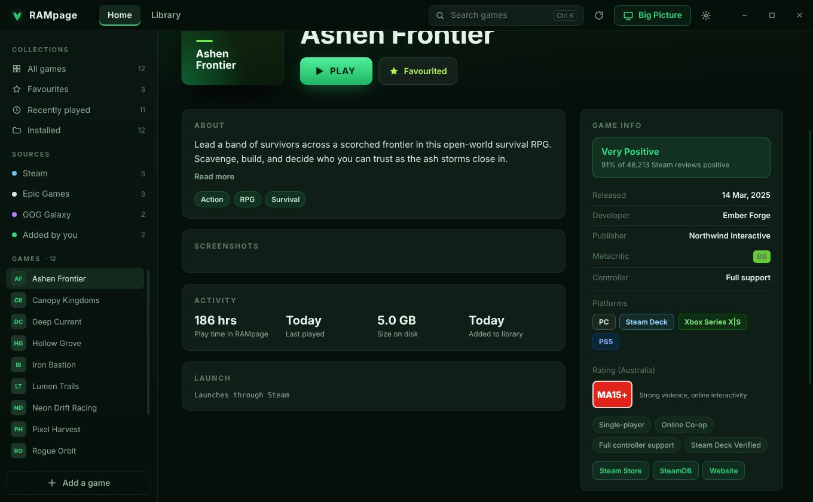
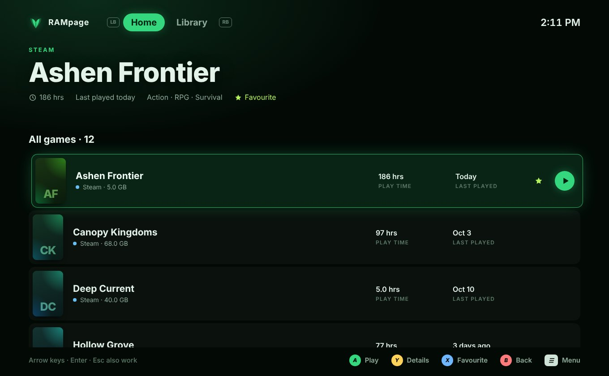
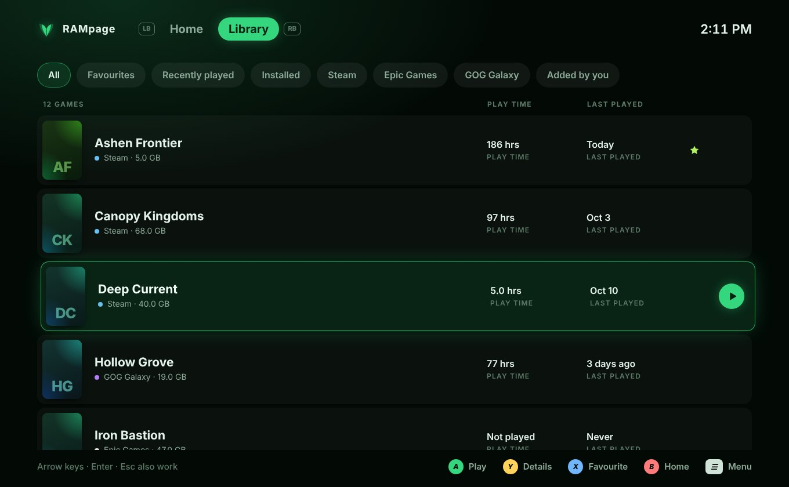
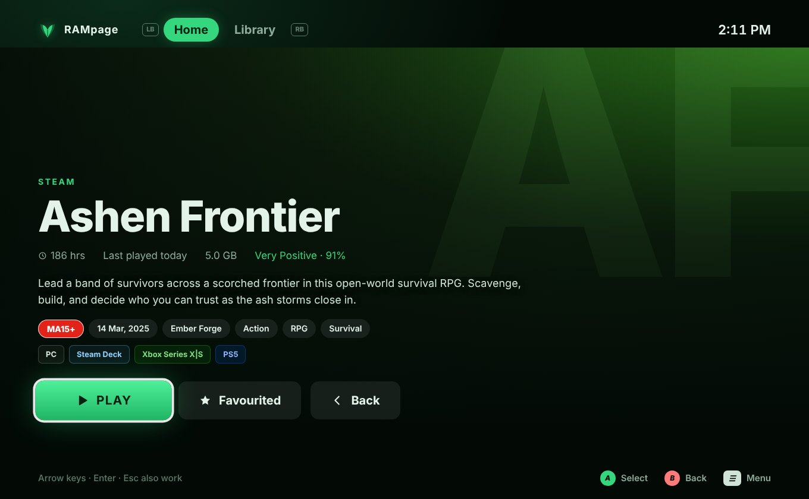
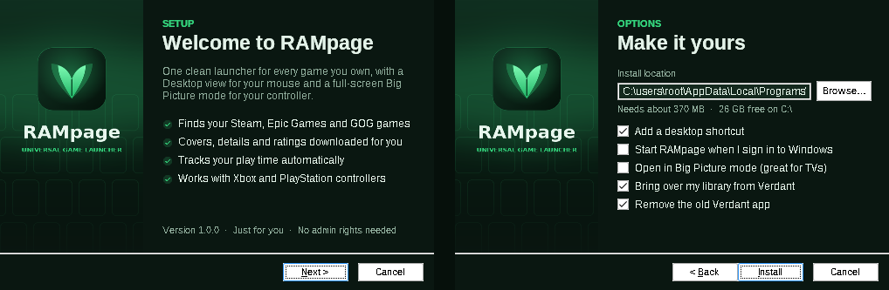

  

  
  
  
  

<h3 align="center">
  Your Steam, Epic Games, GOG and every other game — together in one fast, good-looking library. 
  A tidy Desktop view for your mouse, and a full-screen Big Picture mode for your controller.
</h3>

  

Free · No account needed · Installs just for you, no admin rights

 

## ✨ Why RAMpage

|     |     |
| --- | --- |
| 🎮 **Every launcher, one library** | Finds games installed with **Steam**, **Epic Games** and **GOG Galaxy** automatically — and you can add anything else (emulators, itch.io, Xbox PC games) by picking or dragging in its program file. |
| 🖼️ **Beautiful by default** | Covers, backgrounds, logos and icons are downloaded for you. Don't like one? Search the Steam store from inside RAMpage and pick another, or use your own image. |
| 📺 **Big Picture mode** | A full-screen, controller-first view made for the couch. Works with Xbox, PlayStation and most other controllers — press **☰** on your controller to jump straight in. |
| 📋 **Real game info** | Descriptions, genres, developer and publisher, release dates, Steam review scores, Metacritic, screenshots, platforms (PC, Xbox, PlayStation, Switch…) and the **Australian Classification** rating. |
| ⏱️ **Play-time tracking** | RAMpage records how long and how recently you've played every game — including ones it launches through Steam or Epic. |
| 🔄 **Updates in one click** | **Settings → Check for updates** downloads, verifies and installs new versions for you, then restarts RAMpage. |

 

## 🖥️ Desktop

  

Screenshots show a sample library — with your own games, RAMpage fills in their real covers and artwork.

<table>
  <tr>
    <td width="50%">
<b>Library</b> — filter by collection or store, sort, search with <kbd>Ctrl</kbd>+<kbd>K</kbd>
</td>
    <td width="50%">
<b>Game page</b> — reviews, release info, platforms, rating and screenshots
</td>
  </tr>
</table>

## 📺 Big Picture

  

<table>
  <tr>
    <td width="50%">
<b>Library</b> — a clean list with posters, play time and last played
</td>
    <td width="50%">
<b>Game screen</b> — one press of <kbd>A</kbd> to play
</td>
  </tr>
</table>

### 🎮 Controls

| Action | Controller | Keyboard |
| --- | :---: | :---: |
| Move | D-pad / left stick | <kbd>←</kbd> <kbd>↑</kbd> <kbd>→</kbd> <kbd>↓</kbd> |
| Play / select | **A** | <kbd>Enter</kbd> |
| Back | **B** | <kbd>Esc</kbd> |
| Favourite | **X** | <kbd>F</kbd> |
| Game details | **Y** | <kbd>I</kbd> |
| Switch Home / Library | **LB** / **RB** | <kbd>Tab</kbd> |
| Menu | **☰** | <kbd>M</kbd> |
| Desktop ⇄ Big Picture | **☰** (from Desktop) | <kbd>F11</kbd> |

 

## 📥 Install

1. Download **`RAMpage-Setup-x.x.exe`** from the [latest release](https://github.com/ctrlaltandfix/RAMpage/releases/latest).
2. Run it and follow the short setup — pick where to install, add a desktop shortcut, and choose whether RAMpage starts with Windows or opens in Big Picture.
3. That's it. Your Steam, Epic and GOG games appear as soon as RAMpage opens.

> [!NOTE]
> RAMpage isn't code-signed yet, so Windows SmartScreen may say it "protected your PC" the first time. Click **More info → Run anyway**. Every release on this page includes a `.sha256` file so you can check the installer is exactly the one published here.

  

### Updating

Open **Settings → Check for updates**. RAMpage shows what's new, downloads the update, checks its fingerprint and restarts on the new version — your library, play time, favourites and artwork are kept.

### Uninstalling

Use **Windows Settings → Apps → RAMpage Game Launcher**. Your games themselves are never touched, and you can choose whether to keep your RAMpage library for next time.

 

## ❓ FAQ

<b>Which stores does RAMpage find automatically?</b>

 
Steam (every library folder), the Epic Games Store and GOG Galaxy. Anything else — emulators, itch.io downloads, Xbox PC games, standalone games — can be added with <b>Add a game</b> or by dragging its <code>.exe</code> or shortcut onto the window.

<b>Does RAMpage replace Steam or Epic?</b>

 
No. RAMpage is a launcher that sits on top of them. Store games still launch through their own store, so achievements, cloud saves and friends lists keep working exactly as before.

<b>Where does the artwork and game info come from?</b>

 
From Steam's public store data (covers, backgrounds, logos, icons, descriptions, reviews, screenshots) and Wikidata (console platforms and age ratings). If RAMpage matches the wrong game, open the game and choose <b>Wrong game? Fix match</b>.

<b>Where is my library stored?</b>

 
In <code>%APPDATA%\RAMpage</code>. <b>Settings → Library data</b> shows whether your latest changes are saved and can open that folder.

<b>Something isn't working — how do I report it?</b>

 
Open <b>Settings → Library data → Copy info</b> and include it with a description of what happened in a new <a href="https://github.com/ctrlaltandfix/RAMpage/issues">issue</a>.

 

## ☕ Support RAMpage

RAMpage is free. If you're enjoying it, any small donation helps keep development going.

  

 

  Made for people who just want to play. 💚 RAMpage is not affiliated with Valve, Epic Games, GOG, Microsoft or Sony. Game names and artwork belong to their respective owners.

